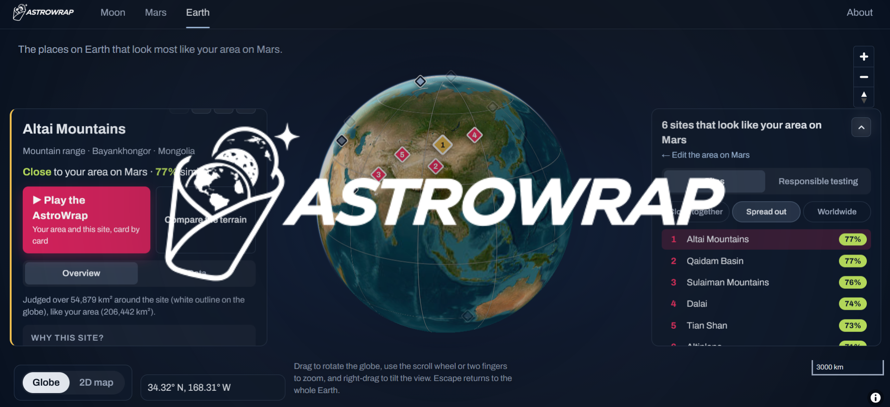
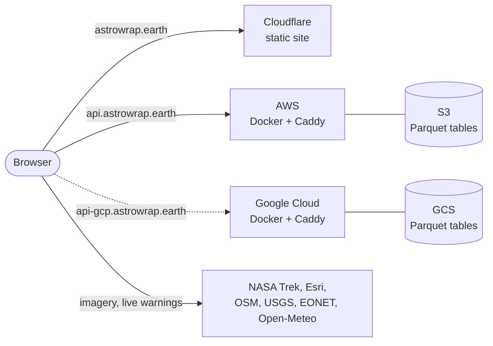

# AstroWrap

**Find the places on Earth that look like your landing site on the Moon or Mars.**

<p align="center">
  
</p>

<p align="center">
  <a href="https://astrowrap.earth"></a>
  <a href="https://www.spaceappschallenge.org/"></a>
  
  <a href="LICENSE"></a>
</p>

AstroWrap is our answer to the NASA Space Apps Challenge 2026 challenge *Identify Earth Locations that Analog the
Permanent Moon Base Locations and Mars*. Before a rover, a lander or a crew leaves for the Moon or Mars, it is tested on
Earth, in places that look like the target site. You paint an area on the Moon or Mars; AstroWrap compares it with the
whole land surface of the Earth, criterion by criterion, and returns the closest analogs, with what makes them alike,
what makes them different, and what a test campaign there would cost the environment.

**Try it:** [astrowrap.earth](https://astrowrap.earth) · **See how it works:** [astrowrap.earth/fonctionnement](https://astrowrap.earth/fonctionnement)

## Contents

- [Features](#features)
- [How it works](#how-it-works)
- [Repository structure](#repository-structure)
- [Technology](#technology)
- [Infrastructure](#infrastructure)
- [Getting started](#getting-started)
- [Data sources and licenses](#data-sources-and-licenses)
- [Team](#team)
- [Use of AI](#use-of-ai)
- [License](#license)

## Features

- **Paint a site** on a 3D globe of the Moon or Mars, with NASA imagery and elevation.
- **Compare it with all of Earth's land**: 613,252 cells, scored on six criteria (terrain, temperature, rocks and
  minerals, wind and dust, ice and water, volcanoes and caves), with adjustable weights.
- **Explore the results**: the top 10 sites at least 300 km apart, known analogs from the literature, a side-by-side
  3D view of both terrains, and a variable-by-variable comparison.
- **Test responsibly**: protected areas, land already transformed by mining, nearest airport and the CO₂ of the flight,
  with a "green mode" that favors low-impact sites.
- **The AstroWrap**: an animated recap of the comparison, ending with live warnings about the site (protected areas,
  earthquakes, natural events, weather extremes).

## How it works

The work happens in two stages.

1. **Pre-processing, once and offline.** Each body is cut into the same hexagonal grid ([H3](https://h3geo.org),
   resolution 5: about 253 km² per cell on Earth, 72 km² on Mars, 19 km² on the Moon). Six independent modules read
   satellite maps and catalogs, and summarize the pixels of each cell into a few comparable numbers. Each module writes
   one small Parquet table per body.
2. **The search, live.** The server averages the painted area into a fingerprint, then compares every Earth cell with
   it, module by module, over a footprint of the same size as the painted area. Cells that keep looking less alike than
   most are dropped, the rest are ranked. A search takes about two seconds.

## Repository structure

| Folder | Content | Documentation |
|---|---|---|
| [`ui/`](ui) | Web interface: globes, area selection, results, AstroWrap recap, About and How it works pages | [ui/README.md](ui/README.md) |
| [`server/`](server) | FastAPI application: search, site cards, 3D terrain, impact | [server/README.md](server/README.md) |
| [`server/deploy/`](server/deploy) | Terraform for AWS and Google Cloud, publishing scripts | [server/deploy/DEPLOY.md](server/deploy/DEPLOY.md) |
| [`modules_pretraitement/`](modules_pretraitement) | The pre-processing modules, one folder each | see below |
| `pretreatment_data/` | Module results (Parquet), not versioned: shared as GitHub releases | [scripts/releases.py](scripts/releases.py) |
| [`scripts/`](scripts) | Environment check, data audit, release publishing | |

Pre-processing modules:

| Module | Criterion | Bodies |
|---|---|---|
| [topography_morphometry](modules_pretraitement/topography_morphometry/README.md) | Slopes, flat ground, roughness, elevation range, craters | Earth, Mars, Moon |
| [thermal_light_extrems](modules_pretraitement/thermal_light_extrems/README.md) | Surface and air temperature, radiation, sunlight, extremes | Earth, Mars, Moon |
| [geology_mineralogy](modules_pretraitement/geology_mineralogy/README.md) | Rock classes and mineral families | Earth, Mars, Moon |
| [mineralogie_terre](modules_pretraitement/mineralogie_terre/README.md) | Earth mineralogy from EMIT, with confidence levels | Earth |
| [wind_erosion_atmosphere](modules_pretraitement/wind_erosion_atmosphere/README.md) | Strong winds, dunes, bare ground, dust | Earth, Mars |
| [volatiles_hydrology_ice](modules_pretraitement/volatiles_hydrology_ice/README.md) | Surface and ground ice, soil water, permanent shadows | Earth, Mars, Moon |
| [astrobiology_habitability_caves](modules_pretraitement/astrobiology_habitability_caves/README.md) | Caves, lava tubes, volcanoes, hot springs, karst, mines | Earth, Mars, Moon |

## Technology

| Layer | Technology |
|---|---|
| Interface | HTML, CSS and JavaScript without framework or bundler; [MapLibre GL](https://maplibre.org) (Earth), [globe.gl](https://globe.gl) and [three.js](https://threejs.org) (Moon, Mars, 3D terrain), [Leaflet](https://leafletjs.com) (2D maps), [h3-js](https://github.com/uber/h3-js) |
| Server | Python, [FastAPI](https://fastapi.tiangolo.com), [Uvicorn](https://www.uvicorn.org), [DuckDB](https://duckdb.org) over Parquet, NumPy, [h3-py](https://github.com/uber/h3-py), rasterio |
| Pre-processing | Python, NumPy, pandas, xarray, rasterio, GeoPandas, earthaccess (NASA Earthdata), h3-py, Parquet and DuckDB |
| Infrastructure | Cloudflare (static site, DNS), AWS and Google Cloud (API), Docker, Caddy, Terraform |

## Infrastructure



| Component | Hosting | Address |
|---|---|---|
| Web interface | Cloudflare Workers (static assets) | [astrowrap.earth](https://astrowrap.earth) |
| API, primary | AWS: one machine behind Caddy (HTTPS), data on a persistent disk synced from S3 | [api.astrowrap.earth](https://api.astrowrap.earth/api/health) |
| API, secondary | Google Cloud: the same Docker image, data synced from Cloud Storage | [api-gcp.astrowrap.earth](https://api-gcp.astrowrap.earth/api/health) |
| Monitoring and logs | CloudWatch (AWS), Cloud Logging (Google Cloud) | |

Both clouds are described in Terraform and deployed with the same image. Setup and commands:
[server/deploy/DEPLOY.md](server/deploy/DEPLOY.md).

## Getting started

Requirements: Node.js 18 or later, Python 3.9 to 3.12.

```bash
git clone https://github.com/roseliz/AstroWrap.git
cd AstroWrap/ui
npm install      # JavaScript libraries, then server/.venv with the server requirements
npm start        # interface on http://localhost:8080, API on http://127.0.0.1:8000
```

The server needs the module results in `pretreatment_data/`. Fetch them from the GitHub releases
(`python scripts/releases.py recuperer <module>`, requires the GitHub CLI), or compute them with each module (see its
README). Details: [ui/README.md](ui/README.md) and [server/README.md](server/README.md).

## Data sources and licenses

AstroWrap only uses public or research data. The values shown are derived per cell; no source dataset is
redistributed. Each module README gives the exact versions, references and attribution requirements.

### Pre-processing (similarity criteria)

| Dataset | Provider | Used for | Terms |
|---|---|---|---|
| MODIS MOD11C3, MYD11C3, MCD12C1 | NASA | Earth surface temperature, land cover | NASA open data |
| MERRA-2 | NASA GMAO | Earth air temperature, radiation, wind, dust | NASA open data |
| VIIRS Deep Blue AERDB | NASA | Earth dust storms | NASA open data |
| EMIT L2A, L2B, L3 | NASA JPL | Earth minerals | NASA open data, cite the DOI |
| EMIT mineral grouping matrix | NASA JPL (emit-sds-l2b) | Earth minerals | Apache 2.0 |
| Copernicus DEM GLO-90 | ESA, Copernicus | Earth elevation, 3D terrain | Free use with attribution |
| ESA CCI Permafrost, Soil Moisture | ESA Climate Change Initiative | Earth ground ice, soil water | Free use with citation |
| RGI 7.0 | NSIDC, GLIMS | Earth glaciers | Citation required |
| JRC Global Surface Water | European Commission JRC | Earth open water | Free use with attribution |
| GLiM | Hartmann and Moosdorf (2012) | Earth rock classes | Citation required |
| Earth Impact Database | PASSC, University of New Brunswick | Earth craters | Citation required |
| Global dune map | Gunn (2026), geomorphlab | Earth dunes | MIT |
| Global-scale mining polygons v2 | Maus et al. (2022), PANGAEA | Earth mines | CC BY-SA 4.0 |
| WOKAM | BGR, IAH, KIT, UNESCO | Earth karst | BGR terms: attribution, copy of publications to BGR |
| Volcanoes of the World | Smithsonian Global Volcanism Program | Earth volcanoes | Citation required |
| OpenStreetMap (Overpass) | OpenStreetMap contributors | Earth caves, hot springs | ODbL |
| Wikidata | Wikimedia | Earth caves, lava tubes | CC0 |
| Natural Earth | Natural Earth | Land mask, glaciers, place names | Public domain |
| MOLA MEGDR | NASA, USGS Astrogeology | Mars elevation, 3D terrain | Public domain |
| Robbins and Hynek (2012), Robbins (2018) | USGS Astrogeology | Mars and Moon craters | Citation required |
| Mars Climate Database v6.2 | LMD, CNES, ESA | Mars temperature, wind, ice | Used with the authorization of the LMD; not redistributed |
| OMEGA global maps | ESA Mars Express, Ody et al. (2012) | Mars minerals | Credit required (see module README) |
| Hydrated mineral sites | Carter et al. (2013), ESA PSA | Mars aqueous sites | Citation required |
| Geologic map SIM 3292 | USGS, Tanaka et al. (2014) | Mars rock classes | Public domain |
| SWIM 2.0 | Planetary Science Institute | Mars ground ice | Citation required |
| Odyssey GRS | NASA PDS | Mars soil water | NASA open data |
| Montabone dust climatology | LMD | Mars dust | CC BY-SA 3.0 |
| Mars Global Digital Dune Database | USGS | Mars dunes | Public domain |
| Mars Global Cave Candidate Catalog | USGS Astrogeology | Mars caves | Public domain |
| LRO Diviner, LOLA | NASA | Moon temperature, elevation, ice, shadows | NASA open data |
| Lunar Prospector | NASA PDS | Moon hydrogen | NASA open data |
| Mineral abundances | Lucey et al. (2021), Zenodo | Moon minerals | CC BY 4.0 |
| Unified Geologic Map of the Moon | USGS (2020) | Moon rock classes | Public domain |
| South polar exposed ice | Lemelin et al. (2021), Zenodo | Moon surface ice | CC BY 4.0 |
| LROC Lunar Pit Atlas | Wagner and Robinson (2021) | Moon pits | Citation required |
| Lunar lava tube evidence | Losarcos and Dombard (2026), Zenodo | Moon lava tubes | CC BY 4.0 |

### Application (server and interface)

| Dataset or service | Provider | Used for | Terms |
|---|---|---|---|
| WDPA | UNEP-WCMC and IUCN, Protected Planet | Protected share of each site | Non-commercial use, derived values only, with citation |
| OurAirports | OurAirports | Nearest airport | Public domain |
| Nominatim | OpenStreetMap contributors | Site names | ODbL, at most one request per second |
| Wikipedia geosearch | Wikimedia | Nearby articles | CC BY-SA (titles and links only) |
| NASA Mars Trek, Moon Trek | NASA | Mars and Moon imagery | Public domain |
| Esri World Imagery | Esri, Maxar, Earthstar Geographics | Earth imagery | Esri terms of use, attribution shown |
| Overpass API | OpenStreetMap contributors | Protected areas near a site (recap) | ODbL |
| USGS Earthquake Catalog | USGS | Earthquakes near a site (recap) | Public domain |
| EONET v3 | NASA | Natural events near a site (recap) | NASA open data |
| Open-Meteo historical weather (ERA5) | Open-Meteo, ECMWF Copernicus | Weather of the past year (recap) | CC BY 4.0 |
| Known analogs | Published literature (cited in `server/services/known_analogs.py`) | Known analogs in the results | Citation |

### Software libraries

| Library | License |
|---|---|
| MapLibre GL JS | BSD-3-Clause |
| globe.gl, three.js | MIT |
| Leaflet | BSD-2-Clause |
| h3-js, h3-py | Apache 2.0 |
| FastAPI, DuckDB | MIT |
| Uvicorn | BSD-3-Clause |

## Team

Alexis Durand, Thibaut Delahaie, Rose Lizé and Laurette Moukoko, for the NASA Space Apps Challenge 2026.

## Use of AI

AI tools helped us write code faster and generate the logo. The overall architecture, the pre-processing pipelines,
the search engine, the design and the ideas behind the system are the team's own work.

## License

The source code is released under the [MIT License](LICENSE). Data obtained from third parties remain under their own
terms, listed in [Data sources and licenses](#data-sources-and-licenses).
