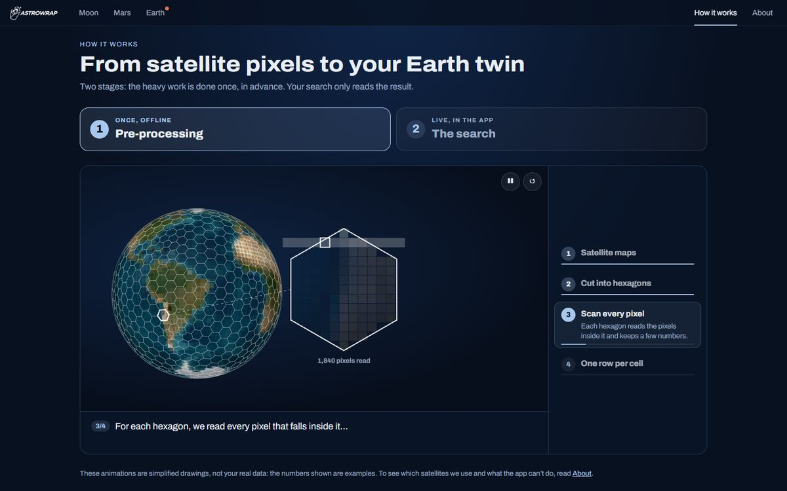
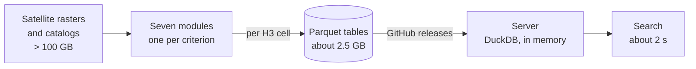

# Pre-processing modules

Raw satellite data is too big and too varied to search in 2 seconds. These modules do the heavy work once, offline,
and turn it into small tables of numbers, one row per hexagonal cell.

## In one picture

| Before | After |
|---|---|
| Rasters and catalogs in many resolutions, projections and formats | One grid, [H3](https://h3geo.org), the same on the Moon, Mars and Earth |
| More than 100 GB downloaded | About 2.5 GB of Parquet |
| Millions of pixels per region | One row per cell: means, shares, percentiles, counts |
| Different units per mission | Same column, same unit, same meaning on the three bodies |

## Example: one cell becomes one row

All the pixels of a source that fall in a cell are summarized into a few columns
(here the `thermal` table of [thermal_light_extrems](thermal_light_extrems/README.md)):

| `h3` | `lst_day_mean` | `lst_night_mean` | `air_temperature_min` | … |
|---|---|---|---|---|
| `85…fffffff` | 312 K | 271 K | 249 K | … |

*Illustrative values.*

The same columns exist in `thermal_earth_h3_5.parquet`, `thermal_mars_h3_5.parquet` and `thermal_moon_h3_5.parquet`,
so a Martian cell and an Earth cell compare directly.

## Resolutions

H3 is defined on a unit sphere: the same cell ids work on every body, only the area changes.

| Resolution | Earth | Mars | Moon | Used for |
|---|---|---|---|---|
| 3 | ~12,400 km² | ~3,500 km² | ~930 km² | Funnel animation of the search |
| **5** | **~253 km²** | **~72 km²** | **~19 km²** | **All module outputs, and the comparison** |
| 6 | ~36 km² | ~10 km² | ~2.7 km² | Painting an area in the interface |

| Body | Cells at resolution 5 |
|---|---|
| Earth | 613,252 (land only) |
| Mars, Moon | 2,016,842 each (whole sphere) |

Resolution 5 separates a crater floor from its rim and keeps the Earth small enough for memory.
Most modules accept `--resolution` for another level. Slopes also depend on the pixel size: the topography module
writes one table per computation base (`_b500` on the three bodies, `_b100` on Earth and the Moon).

## Modules

| Module | Criterion in the app | Bodies | Main sources | Downloaded | Output |
|---|---|---|---|---|---|
| [topography_morphometry](topography_morphometry/README.md) | Terrain | Earth, Mars, Moon | Copernicus GLO-90, MOLA, LOLA, crater catalogs | Earth ~26,000 tiles; Mars 2 GB; Moon 8 GB | 1.7 GB |
| [thermal_light_extrems](thermal_light_extrems/README.md) | Temperature | Earth, Mars, Moon | MODIS, MERRA-2, LRO Diviner, Mars Climate Database | Diviner ~2.8 GB, global MODIS and MERRA-2 | 370 MB |
| [geology_mineralogy](geology_mineralogy/README.md) | Rocks | Earth, Mars, Moon | GLiM, OMEGA, USGS geologic maps, Lucey et al. | ~4 GB | 170 MB |
| [mineralogie_terre](mineralogie_terre/README.md) | Rocks (Earth minerals) | Earth | NASA EMIT | ~25 GB, streamed | 50 MB |
| [wind_erosion_atmosphere](wind_erosion_atmosphere/README.md) | Wind and dust | Earth, Mars | MERRA-2, VIIRS, Mars Climate Database, dune maps | ~14 GB | 56 MB |
| [volatiles_hydrology_ice](volatiles_hydrology_ice/README.md) | Ice and water | Earth, Mars, Moon | ESA CCI, RGI, JRC, SWIM, Diviner, LOLA | up to ~18 GB | 85 MB |
| [astrobiology_habitability_caves](astrobiology_habitability_caves/README.md) | Volcanoes and caves | Earth, Mars, Moon | OpenStreetMap, Wikidata, Smithsonian GVP, USGS, LROC | ~30 MB | 36 MB |

> [!NOTE]
> **Mineralogy was set aside.** We first planned to compare minerals too, and processed the Earth with NASA EMIT
> (`mineralogie_terre`, six Spot machines running in the United States). A fair comparison with Mars would also have
> needed thermal infrared spectra, which was far too large and too long for the challenge. We stopped there rather
> than show a weak comparison: the **Rocks** criterion compares rock classes only. The mineral tables stay in the
> outputs but are not used in the search.

The server also reads `environmental_impact` (WDPA protected areas, OurAirports). It is not a similarity criterion:
it shows what a test campaign would cost the Earth.

Large sources are streamed (download, read, delete), so the disk never holds more than a few GB at once.
Files worth keeping stay in `cache/`.

## Shared conventions

| Rule | Detail |
|---|---|
| Output path | `pretreatment_data/<module>/<table>_<body>_h3_<res>.parquet`, plus `<body>.duckdb` for interactive queries |
| Same columns everywhere | Same name, unit and meaning on Earth, Mars and the Moon |
| `NaN` vs `0` | `NaN`: unknown, no data. `0`: absent, or impossible on that body (no mines on Mars) |
| Earth | Land cells only (Natural Earth), no sea |
| Independent | Each module has its own `requirements.txt`; the one in this folder installs them all |
| Credentials | NASA sources need a free Earthdata account: `EARTHDATA_USERNAME`, `EARTHDATA_PASSWORD` in the environment or a root `.env` (never committed) |

## Running and sharing

| Step | Command |
|---|---|
| Install everything | `pip install -r modules_pretraitement/requirements.txt` |
| Check the machine | `python scripts/verifier.py <module>` (Python, packages, credentials, inputs, disk) |
| Run a module | See its README |
| Audit the results | `python scripts/audit.py <module>` (HTML report in `logs/audit_<module>.html`) |
| Share the results | `python scripts/releases.py publier <module> --note "what changed"` |
| Get the results | `python scripts/releases.py recuperer <module>` |
| List releases | `python scripts/releases.py liste` |

Results are not in git: each run is a zip in a GitHub release.

## Licenses

Each module README lists its sources and required attributions.
Summary: [main README](../README.md#data-sources-and-licenses).
