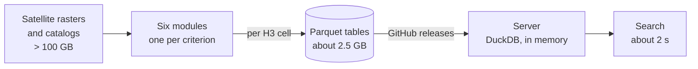

# Pre-processing modules

The search needs to compare one painted area on the Moon or Mars with the whole land surface of the Earth, in about two
seconds. That is impossible on raw data: the sources are satellite rasters and catalogs of very different
resolutions, projections and formats, adding up to more than 100 GB of downloads. The pre-processing modules do the
heavy work once, offline, and reduce everything to small tables that the server can read in memory.

## The idea: one hexagonal grid for three bodies

Every module summarizes its sources over the same grid: [H3](https://h3geo.org), a hierarchy of hexagonal cells that
tiles a sphere. H3 is defined on a unit sphere, so the same cell ids work on the Moon, Mars and Earth; only the area of
a cell changes with the radius of the body.



For each cell, a module reads every pixel or object that falls inside it and keeps a few numbers: means, shares,
percentiles, counts. A whole global raster becomes one row per cell, with columns that mean the same thing on the
three bodies, so that a Martian cell and an Earth cell can be compared directly.

## Resolutions

| Resolution | Cell area: Earth | Mars | Moon | Used for |
|---|---|---|---|---|
| 3 | ~12,400 km² | ~3,500 km² | ~930 km² | Funnel animation of the search (server) |
| **5** | **~253 km²** | **~72 km²** | **~19 km²** | **All module outputs, and the comparison** |
| 6 | ~36 km² | ~10 km² | ~2.7 km² | Painting an area in the interface; each tile counts toward its resolution-5 parent |

Resolution 5 is the trade-off: fine enough to separate a crater floor from its rim, coarse enough to keep the Earth
at 613,252 land cells (Mars and the Moon: 2,016,842 cells each, the whole sphere). Most modules accept
`--resolution` to compute another level. Some metrics also depend on the pixel size of the source: the topography
module computes slopes at a fixed computation base (500 m on the three bodies, 100 m on Earth and the Moon) and writes
one table per base (`_b500`, `_b100`).

## Data reduction

| Module | Downloaded and read (order of magnitude) | Output |
|---|---|---|
| topography_morphometry | Earth: ~26,000 DEM tiles, tens of GB; Mars 2 GB; Moon 8 GB | 1.7 GB (two bases, three bodies) |
| thermal_light_extrems | MODIS, MERRA-2 (global), LRO Diviner ~2.8 GB, Mars Climate Database | 370 MB |
| geology_mineralogy | GLiM 1.2 GB, MODIS land cover 1.2 GB, OMEGA 0.6 GB, Moon abundances 1 GB | 170 MB |
| mineralogie_terre | EMIT: ~25 GB transferred, granules deleted after reading | 50 MB |
| wind_erosion_atmosphere | MERRA-2, VIIRS, MODIS: ~14 GB | 56 MB |
| volatiles_hydrology_ice | JRC Global Surface Water up to ~16 GB, RGI ~1 GB, polar products ~1.2 GB | 85 MB |
| astrobiology_habitability_caves | Catalogs and polygons, ~30 MB | 36 MB |

Large sources are streamed: each tile or granule is downloaded, read and deleted, so the disk never holds more than a
few GB at once. Files worth keeping (Mars and Moon mosaics, catalogs) stay in `cache/`.

## Modules

| Module | Criterion in the app | Bodies | Main sources |
|---|---|---|---|
| [topography_morphometry](topography_morphometry/README.md) | Terrain | Earth, Mars, Moon | Copernicus GLO-90, MOLA, LOLA, crater catalogs |
| [thermal_light_extrems](thermal_light_extrems/README.md) | Temperature | Earth, Mars, Moon | MODIS, MERRA-2, LRO Diviner, Mars Climate Database |
| [geology_mineralogy](geology_mineralogy/README.md) | Rocks | Earth, Mars, Moon | GLiM, OMEGA, USGS geologic maps, Lucey et al. |
| [mineralogie_terre](mineralogie_terre/README.md) | Rocks (Earth minerals) | Earth | NASA EMIT |
| [wind_erosion_atmosphere](wind_erosion_atmosphere/README.md) | Wind and dust | Earth, Mars | MERRA-2, VIIRS, Mars Climate Database, dune maps |
| [volatiles_hydrology_ice](volatiles_hydrology_ice/README.md) | Ice and water | Earth, Mars, Moon | ESA CCI, RGI, JRC, SWIM, Diviner, LOLA |
| [astrobiology_habitability_caves](astrobiology_habitability_caves/README.md) | Volcanoes and caves | Earth, Mars, Moon | OpenStreetMap, Wikidata, Smithsonian GVP, USGS, LROC |

The server also reads an `environmental_impact` table (protected areas from WDPA, nearest airport from OurAirports).
It is not a similarity criterion: it describes what a test campaign would cost the Earth.

## Shared conventions

- **Output layout.** `pretreatment_data/<module>/<table>_<body>_h3_<resolution>.parquet`, one file per table and
  body (for example `thermal_earth_h3_5.parquet`), plus one `<body>.duckdb` per module for interactive queries. The
  server reads only the Parquet files.
- **Same columns on every body.** A column has the same name, unit and meaning on Earth, Mars and the Moon. Each
  module README lists its columns and units.
- **Missing is not zero.** `NaN` means unknown (no data over that cell). `0` means the phenomenon is absent, or
  cannot exist on that body (no mines on Mars, no permanent shadows on Earth).
- **Earth is land only.** Earth cells are those that contain land (Natural Earth); the sea is left out.
- **Independent modules.** Each module has its own `requirements.txt` and runs on its own; `requirements.txt` in this
  folder installs them all.
- **Credentials.** NASA sources need a free Earthdata account: `EARTHDATA_USERNAME` and `EARTHDATA_PASSWORD` in the
  environment or in a `.env` file at the repository root (never committed).

## Running and sharing

Each module README describes its inputs, options and running time. Before a run,
`python scripts/verifier.py <module>` checks Python, packages, credentials, manual inputs and disk space.

The results are not versioned in git. They are shared as GitHub releases, one zip per module run:

```bash
python scripts/releases.py publier   <module> --note "what changed"
python scripts/releases.py recuperer <module>
python scripts/releases.py liste
```

## Licenses

Each module README lists its sources, their licenses and the attributions they require. The summary table is in the
[main README](../README.md#data-sources-and-licenses).
