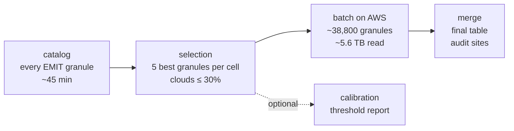

# Earth mineralogy (EMIT, 6 families, 3 confidence levels)

For every H3 cell (resolution 5) of the Earth's arid regions: the share of pixels where each mineral family is
detected, at three confidence levels. It replaces the Earth mineralogy of `geology_mineralogy`.

> [!NOTE]
> **Not used in the search.** Mineralogy was set aside: a fair comparison with Mars would also have needed thermal
> infrared spectra, too large for the challenge. See the [modules README](../README.md#modules).

## Pipeline



From the repository root:

```bash
pip install -r modules_pretraitement/mineralogie_terre/requirements.txt
python modules_pretraitement/mineralogie_terre/scripts/run.py catalog
python modules_pretraitement/mineralogie_terre/scripts/run.py selection
python modules_pretraitement/mineralogie_terre/scripts/run.py calibration   # optional
# worldwide batch on AWS, see infra/README.md
python modules_pretraitement/mineralogie_terre/scripts/run.py merge
```

| Step | Time | Writes |
|---|---|---|
| `catalog` | ~45 min | ~100 MB in `cache/mineralogie_terre/catalogue/` |
| `selection` | a few minutes | `selection.parquet`, the granules to process |
| `calibration` | ~45 min, ~31 GB read | A report of threshold candidates; the thresholds used stay frozen in `thresholds.py` |
| Worldwide batch | on AWS `us-west-2` ([infra/README.md](infra/README.md)) | ~1 GB, to copy into `cache/mineralogie_terre/resultats/` |
| `merge` | minutes | The final table, plus the audit-site check |

Batch command: `batch.py --list selection.parquet --source s3 --production`. `--source https` works from anywhere,
at the speed of your connection. Every step takes `--help`.

Needs a free Earthdata account: `EARTHDATA_USERNAME` and `EARTHDATA_PASSWORD` in the environment or a root `.env`
(never committed).

## The 6 families

| Family | Minerals |
|---|---|
| `oxyde_fer` | hematite, goethite |
| `argile_al` | kaolinite, montmorillonite |
| `argile_fe_mg` | chlorite, vermiculite |
| `mica` | illite, muscovite |
| `carbonate` | calcite, dolomite |
| `sulfate` | gypsum |

Only the 10 minerals validated by EMIT. A library entry counts for a family if it holds at least 10% of it.

## Detection levels

A pixel detects a family when its band depth is at least N times its uncertainty:

| Level | Column suffix | Threshold |
|---|---|---|
| Weak | `_faible` | 2 × uncertainty |
| Medium | `_moyen` | 3 × uncertainty |
| Strong | `_fort` | 5 × uncertainty |

The thresholds were set in advance, not tuned on the sites, and then checked:

| Sites | Role |
|---|---|
| White Sands gypsum (NPS; Fryberger 2001), Cuprite (Swayze et al. 2014), Timanfaya (GVP), Rio Tinto (Fernández-Remolar et al. 2005), Western Australian acid lakes (Benison and Bowen 2006), Saharan coatings (Caquineau et al. 2002), Pinacate, Pilbara, Simpson, Grand Erg Oriental | Calibration |
| Meteor Crater (Shoemaker 1963), Wadi Rum, Hoggar (Assekrem) | Independent audit, never used for calibration |

Sources for each site: `scripts/sites.py`.

## Output

`pretreatment_data/mineralogie_terre/mineralogie_terre_earth_h3_5.parquet` (+ `earth.duckdb`): ~213,000 rows, ~26 MB.
The 141,442 cells of the EMIT arid zone, plus ~72,000 cells seen outside it by granule edges.

| Column | Meaning |
|---|---|
| `det_<family>_faible`, `_moyen`, `_fort` | Share of valid pixels where the family is detected; `NaN` when no pixel is valid |
| `bd_<family>` | Mean band depth of the pixels detected at the medium level |
| `n_valides`, `n_total` | Valid and geolocated pixels, all granules |
| `n_granules` | Granules touching the cell |
| `zone_aride` | Cell of the EMIT arid zone |
| `couverture` | Share of the cell seen in valid pixels by its best granule (0 to 1) |
| `ab_l3_<family>`, `id_case_l3` | EMIT L3 abundance of the 0.5° box holding the cell center (another quantity than `det_*`) |
| `source`, `resolution_source_m`, `id_case_source` | `L2B` (60 m), `L3` (55 km) or `vide` |

`det_*` measures presence and extent, not content. Under dense vegetation, valid pixels with no mineral lower it.

**Filter for comparisons**: `couverture >= 0.5` (keeps 96% of the zone's cells, 75% outside). Outside the arid zone,
granules were not chosen for the cell (~4.4 per cell instead of ~8.7): correct but noisier. The arid zone is not a
geological criterion (it leaves out the Hoggar); `zone_aride` keeps the original perimeter.

### Effect of pixel size

`scale_test.py`, 5 granules, coarser pixels with linear mixing and 60 m noise (pessimistic):

| | 300 m | ~1 km |
|---|---|---|
| 2.2 µm families (clays, carbonates…) | ~0.7 × the 60 m value | ~0.6 × |
| Minor phases (< 5%) | reduced | almost gone |
| Iron oxides | unchanged | unchanged |

Keep this in mind against OMEGA (~1 km) or CRISM (18 to 200 m).

## Method

| Step | Rule |
|---|---|
| Granules | v002 only (v001 finds 4 to 25 × more micas, carbonates, clays on the same cells); arid zone; clouds ≤ 30%; 5 best per cell |
| Valid pixels | Geolocated, no SpecTf-Cloud, cirrus or water flag. The classic cloud flag is not used: it marks ~100% of White Sands under a clear sky |
| Detection | 3 levels above |
| Aggregation | Pixel counts per cell (additive), then shares. No renormalization; `NaN` = not observed |

## Sources and licenses

| Data | For | License |
|---|---|---|
| EMIT L2B MIN v002, MIN and MINUNCERT, 60 m ([10.5067/EMIT/EMITL2BMIN.002](https://doi.org/10.5067/EMIT/EMITL2BMIN.002)) | Mineral, band depth, fit, uncertainty | NASA open data, cite the DOI |
| EMIT L2A MASK v003 ([10.5067/EMIT/EMITL2AMASK.003](https://doi.org/10.5067/EMIT/EMITL2AMASK.003)) | Clouds (SpecTf), cirrus, water | NASA open data, cite the DOI |
| EMIT L3 ASA v002, 0.5° ([10.5067/EMIT/EMITL3ASA.002](https://doi.org/10.5067/EMIT/EMITL3ASA.002)) | Arid zone, coarse abundances | NASA open data, cite the DOI |
| EMIT grouping matrix `mineral_grouping_matrix_20230503.csv` ([emit-sds/emit-sds-l2b](https://github.com/emit-sds/emit-sds-l2b)) | Library entry → 10 minerals | [Apache 2.0](https://github.com/emit-sds/emit-sds-l2b/blob/main/LICENSE); fetched at commit `fba6018`, SHA-256 checked |
| EMIT v002 library entries 295 to 312 (`mineral_id_matrix_v6.00a6.csv`) | Hematite and goethite nano-phases and mixtures, missing from the 2023 matrix | Fractions from the USGS sample names (`V002_ADDITIONS` in `scripts/families.py`) |

## Files

| Path | Content |
|---|---|
| `scripts/run.py` | Entry point, one step at a time |
| `scripts/catalog.py` | CMR search of every EMIT L2B granule (metadata) |
| `scripts/selection.py` | Granules → cells, the K best per cell |
| `scripts/granule.py` | One granule → counts per cell and quality class |
| `scripts/batch.py` | Loop: download, count, delete; resumable, local or AWS |
| `scripts/calibration_list.py`, `calibration.py` | Calibration granules, threshold evaluation |
| `scripts/merge.py` | Counts → final table, audit check |
| `scripts/families.py` | The 6 families, weights per library entry, matrix download |
| `scripts/thresholds.py` | Frozen thresholds |
| `scripts/sites.py` | Calibration and audit sites, with sources |
| `scripts/l3.py` | EMIT L3 reader (its lat axis is shifted by 0.5°) |
| `scripts/scale_test.py` | Coarser-pixel test |
| `scripts/utils.py` | Paths, Earthdata login, DuckDB |
| `infra/` | Terraform for the worldwide AWS run ([infra/README.md](infra/README.md)) |
