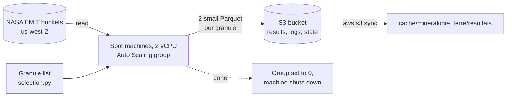

# Worldwide EMIT processing on AWS

Runs `scripts/batch.py` of `mineralogie_terre` on AWS (`us-west-2`), next to the NASA buckets.



If AWS reclaims a Spot machine, the group starts another, which skips the granules already done.

## What gets created

| Resource | Setting |
|---|---|
| S3 bucket | `force_destroy`, public access blocked, objects deleted after 14 days |
| Machine role | Read/write this bucket, read 2 SSM parameters, stop its own group; nothing else |
| Network | Default VPC, no inbound access, no NAT |
| Machine | Amazon Linux 2023, Spot `price-capacity-optimized`, shutdown = termination, disk deleted with it |
| Safeguards | Stops after `max_hours` (36 h), or after `max_starts` (8) machines for one run |
| Budget | Alerts at $10, $20, $30 to `alert_email` (credits excluded, otherwise they never fire) |
| Earthdata credentials | SSM SecureString, created by `credentials.sh`, outside Terraform |

## Needs

| | |
|---|---|
| Tools | Terraform 1.5+, AWS CLI with credentials for the account |
| `.env` (repository root) | `EARTHDATA_USERNAME`, `EARTHDATA_PASSWORD` |
| Alert address | `export TF_VAR_alert_email="you@example.com"`, once per shell (never stored in the code) |
| Granule list | From `scripts/selection.py` |

## Steps

From `modules_pretraitement/mineralogie_terre/infra/`.

| # | Do | Command |
|---|---|---|
| 1 | Store the Earthdata credentials in SSM (read from `.env`, never printed) | `./credentials.sh create` |
| 2 | Build the pilot list (33 granules, `lists/pilot.parquet`) | `python make_list.py` |
| 3 | Start the pilot: it works and shuts down by itself | see below |
| 4 | Copy the pilot results | `aws s3 sync s3://<bucket>/results/pilot ../../../cache/mineralogie_terre/resultats_pilote --region us-west-2` |
| 5 | Full run: `python make_list.py --full`, then step 3 with `run_name=full`, `granule_list=lists/full.parquet` | |
| 6 | Copy the full results where `merge.py` reads them | `aws s3 sync s3://<bucket>/results/full ../../../cache/mineralogie_terre/resultats --region us-west-2` |
| 7 | Destroy everything | `terraform destroy -var "granule_list=lists/full.parquet"` |
| 8 | Delete the credentials and check nothing is left | `./credentials.sh delete && ./check_cleanup.sh` |

Step 3:

```bash
terraform init
terraform plan -var "granule_list=lists/pilot.parquet" -var "run_name=pilot" -out pilot.tfplan
terraform apply pilot.tfplan
```

## Monitoring

| What | Where |
|---|---|
| Machine logs, every 5 min | `s3://<bucket>/logs/<run>/<machine>.log` |
| Progress | `s3://<bucket>/state/<run>/` |
| Live logs | `aws logs tail /mineralogie_terre --follow` |

Generated files stay local and git-ignored: `.terraform/`, state and plan files, `.build/`, `lists/`.
