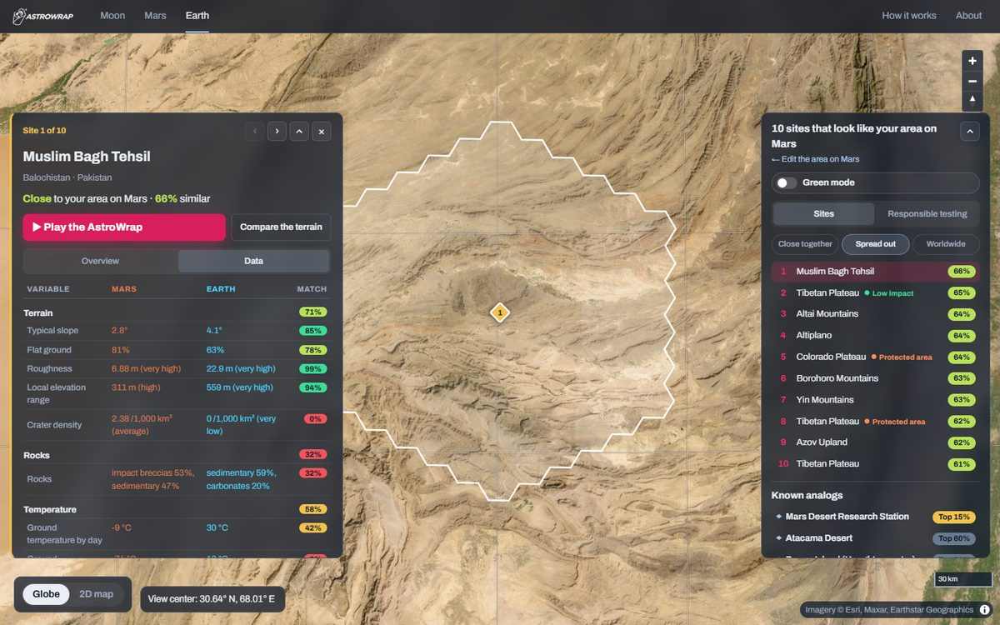

# Thermal conditions, illumination and extremes

Surface and air temperatures, radiation, sunlight and hot or cold extremes for every H3 cell (resolution 5) of the
Earth, Mars and the Moon. In the app it is the **Temperature** criterion.



## Quick start

From the repository root:

```bash
pip install -r modules_pretraitement/thermal_light_extrems/requirements.txt
python modules_pretraitement/thermal_light_extrems/scripts/lancer_3_corps.py --corps mars
```

| Command | Time | Needs |
|---|---|---|
| `--corps mars` | ~1 min | MCD files in `inputs/mcd/` (see below) |
| `--corps moon` | download ~2.8 GB | nothing, Diviner and LOLA download from PDS |
| `--corps earth --zone -115 31 -109 37` | shorter compute, same download | Earthdata account |
| no `--corps` | the three | all of the above |

| Resource | Need |
|---|---|
| Disk | 3 to 4 GB in `cache/thermal_light_extrems/`, deleted as it goes |
| RAM | 8 GB for Earth; on smaller machines, one body at a time |

The code lives in `notebooks/pretraitement_thermique_3_corps.ipynb`. `scripts/lancer_3_corps.py` runs its cells
without Jupyter and overrides the parameters: **editing the notebook is enough to change the processing.**

## Sources

| | Earth | Moon | Mars |
|---|---|---|---|
| Surface temperature (`lst_*`) | MODIS MOD11C3 + MYD11C3 v061, monthly, 0.05° | LRO Diviner, Global Cumulative Product, 0.5° × local time | Mars Climate Database v6.2, `tsurf` |
| Air temperature | MERRA-2 M2SMNXSLV (`T2MMAX`, `T2MMEAN`, `T2MMIN`) | none (`NaN`) | MCD `temp`, lowest level |
| Solar, infrared, clouds | MERRA-2 M2TMNXRAD (`SWGDN`, `LWGAB`, `CLDTOT`) | computed; 0; 0 (no atmosphere) | MCD `fluxsurf_dn_sw`, `fluxsurf_lw`; clouds `NaN` |
| Sunlight fraction | astronomy | astronomy; LOLA at the poles | astronomy |

| Body | Setup |
|---|---|
| Moon | Nothing |
| Earth | [NASA Earthdata](https://urs.earthdata.nasa.gov) account in `~/.netrc`, and authorize **NASA GESDISC DATA ARCHIVE** in Profile → Applications (otherwise HTTP 401) |
| Mars | MCD files copied by hand into `inputs/mcd/` |

### Mars Climate Database

Free for science, on request to the LMD: [request form](https://www-mars.lmd.jussieu.fr/MCD_pro/mcd_pro.html).
**Never redistribute it, even partly**: no MCD file in git or in a release.

```bash
mkdir -p inputs/mcd
tar -xzf MCD_6.2.tar.gz -C inputs/mcd --wildcards '*clim_aveEUV/clim_??_me.nc'
```

Needs the 12 files `clim_01_me.nc` … `clim_12_me.nc`. Without them, Mars is skipped with a message.

## Options

| Option | Effect |
|---|---|
| `--corps moon earth mars` | Bodies (default: all three) |
| `--annee 2023` | Year of the Earth data |
| `--zone W S E N` | Earth: only this box (MODIS and MERRA-2 are global, so the download stays the same) |
| `--mcd /path` | MCD folder other than `inputs/mcd/` |
| `--resolution 5` | H3 resolution |

## Output

`pretreatment_data/thermal_light_extrems/<table>_<body>_h3_5.parquet`, plus `<body>.duckdb`.
Every table starts with `body`, `resolution`, `h3`.

| Table | Columns |
|---|---|
| `thermal` | `lst_day_mean/min/max`, `lst_night_mean/min/max`, `air_temperature_mean/min/max` |
| `illumination` | `shortwave_radiation_mean`, `longwave_radiation_mean`, `sunshine_duration_mean`, `daylight_duration_mean`, `cloud_fraction_mean`, `daylight_fraction`, `daylight_fraction_min`, `daylight_fraction_max` |
| `extremes` | `lst_day_p05/p95`, `lst_night_p05/p95`, `air_temperature_p05/p95`, `hot_pixel_count`, `cold_pixel_count`, `hot_fraction`, `cold_fraction` |
| all three | `pixel_count`, `valid_pixel_count`, `masked_pixel_count`, `coverage`, `source_resolution_km`, `reliability` |

| Quantity | Unit |
|---|---|
| Temperature | K |
| Radiation | W/m² |
| Duration | hours per day of the body: Earth 24, Mars 24.66, Moon 708.7 |
| `daylight_fraction*`, `coverage`, `reliability`, `hot_fraction`, `cold_fraction` | 0 to 1 |

## Conventions

| Topic | Rule |
|---|---|
| Day and night | MODIS overpass times, local solar time: day 10:30 and 13:30, night 22:30 and 01:30. Mars: MCD interpolated to these times. Moon: Diviner every 15 min inside these windows |
| Hot, cold | Relative to each body: hot above its 90th percentile of day temperatures, cold below its 10th (area-weighted). Thresholds in `seuils_extremes_<body>.json` |
| Daylight | `daylight_fraction` ≈ 0.5 almost everywhere; latitude shows in `_min` (shortest day) and `_max` (longest day): 0 polar night, 1 midnight sun. Lunar poles scaled with LOLA mean illumination |
| Observation | One source pixel × one date. `masked_pixel_count` is 0: no land-cover mask yet |
| Earth | MODIS over land only, cloudy pixels removed by MODIS: **clear-sky temperatures only** |

Why relative extremes? With fixed thresholds (313 K, 253 K), Mars is never hot and the Moon is hot every day.

### Reliability

```text
reliability = coverage / (1 + log2(source_pixel_size / cell_size))     (1 when the source is finer than the cell)
```

| Body | Source | Pixel | Reliability |
|---|---|---|---|
| Earth | MODIS | 5.6 km | 1 |
| Earth | MERRA-2 (illumination) | 62 km | lower |
| Moon | Diviner | 15.2 km | lower |
| Mars | MCD | 272 km | ~0.17 (one pixel ≈ 700 cells) |

## Files

| Path | Content |
|---|---|
| `notebooks/pretraitement_thermique_3_corps.ipynb` | All the code, three bodies |
| `scripts/lancer_3_corps.py` | Runs the notebook from the command line |
| `requirements.txt` | Dependencies |
| `inputs/mcd/` (repository root) | Mars Climate Database, by hand, never committed |
