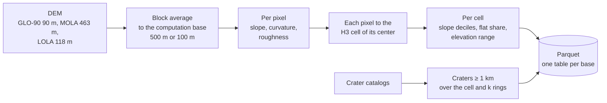

# Topography, Morphometry, and Craters

Terrain morphology of each H3 cell (resolution 5 by default) on **Earth, Mars, and the Moon, at all latitudes**: slope distribution, flat-terrain fraction, roughness, elevation range, curvature, and crater density.

Slopes depend on pixel size, so the module computes every metric at a fixed **computation base**. The **500 m** base covers all three bodies (it matches the Mars DEM resolution). The **100 m** base covers Earth and the Moon only. Compare bodies only at the same base.

## Files

```text
requirements.txt            Python dependencies of the module
scripts/pretraitement.py    Preprocessing script for the three bodies (entry point)
scripts/utils.py            Helpers: free-space check, path display, DuckDB export
crateres_terre.csv          Terrestrial impact structures (not bundled yet, see "Earth craters")
```

Paths below are relative to the repository root. The script creates these folders there:

| Folder | Content |
| :--- | :--- |
| `cache/topography_morphometry/` | Downloaded DEMs and crater catalogs (up to ~10 GB) |
| `inputs/topography_morphometry/` | Optional manually downloaded sources (see "Manual downloads") |
| `pretreatment_data/topography_morphometry/` | Outputs (Parquet and DuckDB) |

## Installation

Requires Python 3.10 or later.

```bash
python -m venv .venv
```

```bash
.venv/Scripts/activate        # Windows (Git Bash); on Linux/macOS: source .venv/bin/activate
```

```bash
pip install -r modules_pretraitement/topography_morphometry/requirements.txt
```

`modules_pretraitement/requirements.txt` installs the dependencies of every preprocessing module, plus `ipykernel` for notebooks.

## Sources

Every source except the Earth crater list downloads automatically. None of them needs an account.

| Body | Source | Purpose | Download and storage |
| :--- | :--- | :--- | :--- |
| Earth | **Copernicus DEM GLO-90** (ESA), 3″ pixels (~90 m), 1° tiles | Elevation | ~26,000 tiles from AWS Open Data, each deleted after it is read (tens of GB transferred, a few MB on disk at a time) |
| Earth | **Earth Impact Database** (PASSC, University of New Brunswick) | Craters | Local file `crateres_terre.csv` (see "Earth craters") |
| Mars | **MOLA MEGDR** (Mars Global Surveyor), USGS 463 m global mosaic | Elevation | 2 GB, kept in `cache/` |
| Mars | **Robbins & Hynek (2012) catalog**, ~384,000 craters (≥ 1 km) | Craters | USGS pygeoapi service, kept in `cache/` |
| Moon | **LOLA LDEM** (Lunar Reconnaissance Orbiter), USGS 118 m global mosaic | Elevation | 8 GB, kept in `cache/` |
| Moon | **Robbins (2018) catalog**, ~1.3 million craters | Craters | USGS Astropedia (~90 MB), kept in `cache/` |

### Manual downloads

If an automatic download fails (firewall, server down), download the file yourself and put it in the matching `inputs/topography_morphometry/` folder. You can also pass its path with the option listed. Local files always take priority over downloads.

| Source | Folder | Option |
| :--- | :--- | :--- |
| Mars DEM: <https://planetarymaps.usgs.gov/mosaic/Mars_MGS_MOLA_DEM_mosaic_global_463m.tif> | `mnt_mars/` | `--mnt-mars` |
| Moon DEM: <https://planetarymaps.usgs.gov/mosaic/Lunar_LRO_LOLA_Global_LDEM_118m_Mar2014.tif> | `mnt_lune/` | `--mnt-lune` |
| Mars craters: [Robbins 2012 database](https://astrogeology.usgs.gov/search/map/mars_crater_database_robbins_2012) (`.tsv`) | `crateres_mars/` | `--crateres-mars` |
| Moon craters: [Robbins 2018 database](https://astrogeology.usgs.gov/search/map/moon_crater_database_v1_robbins) (`.csv`) | `crateres_lune/` | `--crateres-lune` |

A folder can hold several files. The script uses the largest `.tif`, or the largest `.csv`, `.tsv` or `.txt`. It detects the latitude, longitude and diameter columns of crater catalogs automatically.

### Earth craters

`crateres_terre.csv` is not in the repository yet. Without it, Earth is still processed, but `densite_crateres` is left empty. To add it, export the confirmed structures of the [Earth Impact Database](http://www.passc.net/EarthImpactDatabase/) to a CSV file. It needs a latitude column (`lat`), a longitude column (`lon`, degrees east, negative for west) and a diameter column in kilometers (`diameter_km`). Save it as `modules_pretraitement/topography_morphometry/crateres_terre.csv`, or pass another path with `--crateres-terre`.

## Running the script

Run these commands from the repository root:

```bash
python modules_pretraitement/topography_morphometry/scripts/pretraitement.py --corps mars
```

```bash
python modules_pretraitement/topography_morphometry/scripts/pretraitement.py --corps moon
```

```bash
python modules_pretraitement/topography_morphometry/scripts/pretraitement.py --corps earth
```

```bash
python modules_pretraitement/topography_morphometry/scripts/pretraitement.py
```

The first three commands process one body each: Mars takes ~10 min after the 2 GB download, the Moon 30 min to 1 h after the 8 GB download, and Earth several hours, mostly spent downloading. Without `--corps`, the last command processes the three bodies one after another.

The three bodies can run at the same time in separate terminals. Each one writes its own files. Plan for ~3 GB of RAM per body.

| Option | Effect |
| :--- | :--- |
| `--corps earth mars moon` | Bodies to process (default: all three) |
| `--resolution 5` | H3 resolution |
| `--bases 500 100` | Computation bases in meters (default: both; Mars supports 500 only) |
| `--crateres-seulement` | Only recompute `densite_crateres` in the existing outputs (takes seconds) |
| `--zone W S E N` | Earth: only download and process the tiles inside this box, in degrees (for tests) |
| `--telechargements 6` | Earth: number of tiles downloaded in parallel |
| `--crateres-terre` | Earth: terrestrial impact structures CSV file |
| `--mnt-mars`, `--mnt-lune` | DEM already downloaded (file or folder) |
| `--crateres-mars`, `--crateres-lune` | Crater catalog already downloaded (file or folder) |
| `--echelle-lune 0.5` | Meters per lunar DEM unit, when the file metadata does not give it |

Quick Earth test on Meteor Crater (4 tiles):

```bash
python modules_pretraitement/topography_morphometry/scripts/pretraitement.py --corps earth --zone -112 34 -110 36
```

### Outputs

The script writes to `pretreatment_data/topography_morphometry/`:

* one Parquet file per body and base, `topography_morphometry_{body}_h3_{resolution}_b{base}.parquet`. Its schema metadata records the module, body, base and sources.
* one DuckDB database per body, `{earth,mars,moon}.duckdb`, with one table per Parquet file of that body. The database is rebuilt from the Parquet files after each write.

After each write, the script prints the values of a few known reference sites and the medians as a sanity check. Examples are Meteor Crater, Gale and Apollo 11.

## Output columns

`body`, `resolution`, `h3`, followed by:

| Column | Definition |
| :--- | :--- |
| `base_m` | Nominal computation base (500 or 100 m); only compare rows with the same base |
| `base_effective_m` | Actual pixel side used (Earth 463 and 93 m, Mars 463 m, Moon 474 and 118 m) |
| `resolution_source_m` | Pixel size of the source DEM (90, 463 or 118 m) |
| `pente_p10` … `pente_p90` | Slope deciles (°) within the cell (for the Wasserstein distance) |
| `pente_moy` | Mean slope (°) |
| `part_pente_inf_5` | Fraction of pixels with a slope < 5° (landing-site suitability) |
| `rugosite_rms` | RMS difference between each pixel elevation and the mean of its 3 × 3 window (m) |
| `denivele_p5_p95` | Difference between the 5th and 95th elevation percentiles (m) |
| `courbure_moy` | Mean curvature (minus the elevation Laplacian, km⁻¹): > 0 convex, < 0 concave |
| `courbure_abs_moy` | Mean absolute curvature (km⁻¹): overall intensity of concavity and convexity |
| `densite_crateres` | Craters ≥ 1 km in diameter per 1,000 km², counted over the cell and its neighbors (see "Method"); empty when no catalog is available |
| `n_pixels` | Number of pixels used in the statistics (1 in 9 for Earth at the 100 m base) |
| `couverture` | Fraction of the cell covered by valid DEM elevations (on Earth, sea and missing tiles count as empty) |
| `fiabilite` | Equal to `couverture` for now (placeholder) |

## Method



* **Computation base**: the script block-averages the DEM pixels to reach the target base. For example, it uses 5 × 5 pixels of 3″ for Earth at 500 m and 4 × 4 pixels for the Moon at 500 m. Near the poles, meridians converge, so the script groups more columns to keep the pixels roughly square up to high latitudes.
* **Slope and curvature**: central differences on the sphere; the slope is atan(|∇z|). The curvature is the discrete Laplacian, and the roughness is the deviation from the 3 × 3 mean.
* **Cell assignment**: each pixel goes to the H3 cell of its center. The script looks up cells by blocks of about 1/8 of a cell side. It reads each DEM from north to south and computes a cell as soon as all of its pixels have been read, so the deciles are exact. At the 100 m base, Earth keeps one pixel in 3 along each axis, so ~3,000 pixels per cell. This sampling has a negligible effect on the deciles.
* **Earth data**: an elevation of 0 is treated as sea, because Copernicus writes 0 over the ocean and has no offshore tiles. A cell is kept only if it has at least one land pixel.
* **Craters**: at resolution 5, cells are small (Moon ~19 km², Mars ~72 km², Earth ~253 km²) and rarely contain a crater. Each density therefore counts the craters ≥ 1 km in the cell and the k rings around it. k is chosen so that the window covers at least ~1,000 km²: Earth 1 ring (~1,800 km²), Mars 2 rings (~1,400 km²), Moon 4 rings (~1,100 km²).

## Limitations

* **Gravity**: the same slope is not equally stable under different surface gravities (Mars 0.38 g, Moon 0.17 g).
* **Elevation range**: `denivele_p5_p95` depends on the cell area, which varies with latitude and body, so compare it with care. Slopes, roughness and curvature are standardized by the computation base.
* **Terrestrial craters**: impact structures on Earth are heavily eroded (167 confirmed ones are ≥ 1 km). `densite_crateres` is close to zero almost everywhere and mostly flags known impact sites such as Meteor Crater, Haughton and Ries.
* **Water bodies**: lakes are flat in the Copernicus DEM, which inflates `part_pente_inf_5`.
* **Poles**: on Mars beyond ±88° and at the lunar poles, the DEMs are interpolated between altimeter tracks, so the values there are less reliable.
* **High resolution**: fine local DEMs (30 m on Earth, CTX, HiRISE, SLDEM, 5 m polar LOLA) are not used by this module. High-resolution processing is meant to happen later, on the cells selected after comparison.
