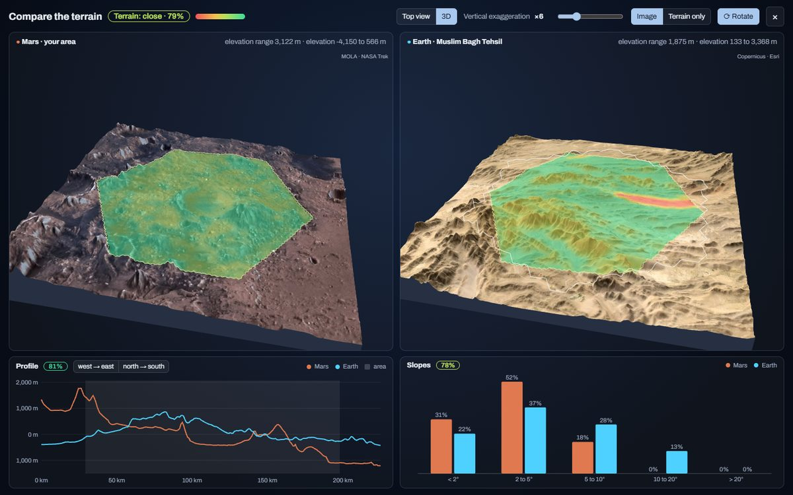
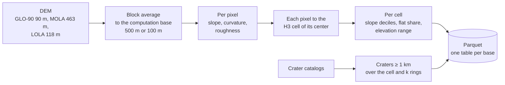

# Topography, morphometry and craters

The shape of the ground in every H3 cell (resolution 5) of the Earth, Mars and the Moon: slopes, flat share,
roughness, elevation range, curvature and crater density. In the app it is the **Terrain** criterion.



## Quick start

From the repository root (Python 3.10+):

```bash
pip install -r modules_pretraitement/topography_morphometry/requirements.txt
python modules_pretraitement/topography_morphometry/scripts/pretraitement.py --corps mars
```

| Command | Time | Download |
|---|---|---|
| `--corps mars` | ~10 min | 2 GB, kept |
| `--corps moon` | 30 min to 1 h | 8 GB, kept |
| `--corps earth` | several hours | ~26,000 tiles, deleted after reading |
| no `--corps` | the three, one after another | |
| `--corps earth --zone -112 34 -110 36` | a few minutes | 4 tiles around Meteor Crater (test) |

The three bodies can run at the same time in separate terminals (~3 GB of RAM each).
No account needed.

## Computation base

Slopes depend on pixel size, so every metric is computed at a fixed base. **Only compare rows with the same base.**

| Base | Earth | Mars | Moon |
|---|---|---|---|
| **500 m** | 5 × 5 pixels of 90 m | MOLA pixel (463 m) | 4 × 4 pixels of 118 m |
| **100 m** | 1 pixel in 3 per axis, ~3,000 per cell | not available | LOLA pixel (118 m) |

## Method



| Step | How |
|---|---|
| Block average | Near the poles, more columns are grouped so pixels stay about square |
| Slope | Arctangent of the elevation gradient, central differences on the sphere |
| Curvature | Minus the discrete Laplacian |
| Roughness | Deviation from the 3 × 3 mean |
| Cell assignment | Read north to south; a cell is computed once all its pixels are read, so deciles are exact |
| Earth sea | Elevation 0 = sea (Copernicus has no offshore tiles); a cell needs at least one land pixel |
| Craters | Cells rarely hold a crater, so the count covers the cell + k rings, at least ~1,000 km² |

| Body | Crater window |
|---|---|
| Earth | 1 ring, ~1,800 km² |
| Mars | 2 rings, ~1,400 km² |
| Moon | 4 rings, ~1,100 km² |

## Output

`pretreatment_data/topography_morphometry/topography_morphometry_<body>_h3_5_b<base>.parquet`, plus `<body>.duckdb`.
After each run, the script prints a few known sites (Meteor Crater, Gale, Apollo 11) and the medians as a sanity check.

| Column | Meaning | Unit |
|---|---|---|
| `body`, `resolution`, `h3` | Cell | |
| `base_m` | Computation base: 500 or 100 | m |
| `base_effective_m` | Actual pixel side (Earth 463/93, Mars 463, Moon 474/118) | m |
| `resolution_source_m` | Source DEM pixel (90, 463, 118) | m |
| `pente_p10` … `pente_p90` | Slope deciles in the cell | ° |
| `pente_moy` | Mean slope | ° |
| `part_pente_inf_5` | Share of pixels under 5° (landing sites) | 0–1 |
| `rugosite_rms` | RMS gap to the 3 × 3 mean | m |
| `denivele_p5_p95` | Elevation range, 5th to 95th percentile | m |
| `courbure_moy` | Mean curvature: > 0 convex, < 0 concave | km⁻¹ |
| `courbure_abs_moy` | Mean absolute curvature | km⁻¹ |
| `densite_crateres` | Craters ≥ 1 km per 1,000 km²; empty without a catalog | |
| `n_pixels` | Pixels used | |
| `couverture` | Share of the cell with valid elevations | 0–1 |
| `fiabilite` | Same as `couverture` for now | 0–1 |

## Sources

All download automatically, except the Earth crater list.

| Body | Source | For | Download |
|---|---|---|---|
| Earth | Copernicus DEM GLO-90 (ESA), 90 m, 1° tiles | Elevation | AWS Open Data, each tile deleted after reading |
| Earth | Earth Impact Database (PASSC, UNB) | Craters | Local `crateres_terre.csv`, see below |
| Mars | MOLA MEGDR (MGS), USGS 463 m mosaic | Elevation | 2 GB, in `cache/` |
| Mars | Robbins & Hynek 2012, ~384,000 craters ≥ 1 km | Craters | USGS pygeoapi, in `cache/` |
| Moon | LOLA LDEM (LRO), USGS 118 m mosaic | Elevation | 8 GB, in `cache/` |
| Moon | Robbins 2018, ~1.3 million craters | Craters | USGS Astropedia, ~90 MB, in `cache/` |

**Earth craters**: `crateres_terre.csv` is not in the repository yet. Without it Earth still runs, with
`densite_crateres` empty. To add it, export the confirmed structures of the
[Earth Impact Database](http://www.passc.net/EarthImpactDatabase/) with columns `lat`, `lon` (degrees east) and
`diameter_km`.

### If a download fails

Put the file in `inputs/topography_morphometry/<folder>/`, or pass its path. Local files always win.

| Source | Folder | Option |
|---|---|---|
| [Mars DEM](https://planetarymaps.usgs.gov/mosaic/Mars_MGS_MOLA_DEM_mosaic_global_463m.tif) | `mnt_mars/` | `--mnt-mars` |
| [Moon DEM](https://planetarymaps.usgs.gov/mosaic/Lunar_LRO_LOLA_Global_LDEM_118m_Mar2014.tif) | `mnt_lune/` | `--mnt-lune` |
| [Mars craters](https://astrogeology.usgs.gov/search/map/mars_crater_database_robbins_2012) (`.tsv`) | `crateres_mars/` | `--crateres-mars` |
| [Moon craters](https://astrogeology.usgs.gov/search/map/moon_crater_database_v1_robbins) (`.csv`) | `crateres_lune/` | `--crateres-lune` |

The largest `.tif` (or `.csv`, `.tsv`, `.txt`) of a folder is used; crater columns are detected automatically.

## Options

| Option | Effect |
|---|---|
| `--corps earth mars moon` | Bodies (default: all three) |
| `--resolution 5` | H3 resolution |
| `--bases 500 100` | Computation bases (Mars: 500 only) |
| `--crateres-seulement` | Only recompute `densite_crateres` (seconds) |
| `--zone W S E N` | Earth: only this box, in degrees (tests) |
| `--telechargements 6` | Earth: parallel tile downloads |
| `--crateres-terre` | Earth crater CSV |
| `--mnt-mars`, `--mnt-lune` | DEM already downloaded |
| `--crateres-mars`, `--crateres-lune` | Crater catalog already downloaded |
| `--echelle-lune 0.5` | Meters per lunar DEM unit, if the file doesn't say |

## Files

| Path | Content |
|---|---|
| `scripts/pretraitement.py` | Entry point, three bodies |
| `scripts/utils.py` | Free space, paths, DuckDB export |
| `cache/topography_morphometry/` | Downloaded DEMs and catalogs (up to ~10 GB) |
| `inputs/topography_morphometry/` | Manual downloads |
| `pretreatment_data/topography_morphometry/` | Outputs |

## Limits

| Limit | Effect |
|---|---|
| Gravity | The same slope is not equally stable at 0.38 g (Mars) or 0.17 g (Moon) |
| Elevation range | `denivele_p5_p95` grows with cell area, which varies by latitude and body |
| Earth craters | Heavily eroded (167 confirmed ≥ 1 km): density is near zero except at Meteor Crater, Haughton, Ries… |
| Lakes | Flat in Copernicus, so they inflate `part_pente_inf_5` |
| Poles | Mars beyond ±88° and the lunar poles are interpolated between altimeter tracks |
| Fine DEMs | 30 m Earth, CTX, HiRISE, SLDEM, 5 m polar LOLA: not used here, meant for later on selected cells |
