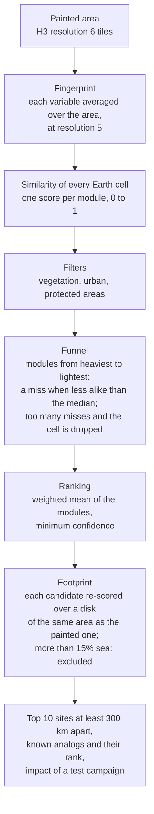

# AstroWrap server

FastAPI, read-only over the module results in `pretreatment_data/`.
One request compares a painted area of Mars or the Moon with the 613,252 land cells of the Earth, in about 3 s.

## Quick start

```bash
cd ui
npm install    # creates server/.venv
npm run api    # http://127.0.0.1:8000, interactive docs at /docs
```

By hand, from `server/` (Linux, macOS: `source .venv/bin/activate`):

```bash
python -m venv .venv
.venv\Scripts\activate
pip install -r requirements.txt
uvicorn main:app --port 8000
```

The Earth loads in the background (about 10 s). Ready when `GET /api/health` returns `"ready": true`.

## Endpoints

All under `/api`. Interactive docs at `/docs`.

| Method | Path | Returns | Used by |
|---|---|---|---|
| `GET` | `/health` | Earth loaded or not, modules found | startup check |
| `GET` | `/modules` | The six criteria and their availability per body | |
| `GET` | `/presets` | Weight presets: Balanced, Landing site, Geology, Astrobiology, Extreme climate | |
| `POST` | `/search` | Top sites, funnel, pool for re-weighting, known analogs | results page |
| `POST` | `/search/detail` | Every variable of one Earth site against the area, over the footprint | Data tab |
| `POST` | `/zones` | Saves an area, returns a 12-character id | link in the address bar |
| `GET` | `/zones/{id}` | The saved area | opening a shared link |
| `POST` | `/zones/terrain` | Flat ground share of the area | Landing site mission |
| `GET` | `/site/{cell}` | Site card: place name and module values of one cell | site card |
| `POST` | `/names` | Quick names of up to 100 cells | ranking list |
| `GET` | `/relief` | Heights and imagery of a square around a point | Compare the terrain |

## Example

**Request**: three resolution-6 cells near Jezero, Mars.

```bash
curl -X POST http://127.0.0.1:8000/api/search \
  -H "content-type: application/json" \
  -d '{"body": "mars",
       "h3_cells": ["866080007ffffff", "86608000fffffff", "866080017ffffff"],
       "top_k": 10}'
```

Optional fields: `preset`, `weights` (`{"topography": 3, ...}`), `modules`, `filters` (`max_vegetation`, `max_urban`, `max_protected`, 0 to 1).

**Response** (shortened):

```jsonc
{
  "n_cells_earth": 613252,
  "active_modules": ["topography", "geology", "thermal", "wind", "volatiles"],
  "inactive_modules": [{ "key": "astro", "reason": "no data on the area" }],
  "weights": { "topography": 0.2, "geology": 0.2, "thermal": 0.2, "wind": 0.2, "volatiles": 0.2 },
  "funnel": [{ "stage": "start", "cells_remaining": 613252, "message": "Land cells" }, ...],
  "best_cells": [
    { "h3": "8525a9c7fffffff",                       // Altai Mountains, Mongolia
      "score": 0.728, "confidence": 0.8,
      "score_per_module": { "topography": 0.708, "thermal": 0.539, "wind": 0.922, "volatiles": 0.972 } },
    ...
  ],
  "footprint": { "rings": 0, "cells": 1, "area_km2": 253, "zone_area_km2": 31 },
  "pool": { "h3": [...19,930 cells], "score_per_module": {...}, "impact": { "protected": [...], "mines": [...] } },
  "known": [{ "name": "Devon Island (Haughton crater)", "country": "Canada", ... }, ...],
  "duration_s": 2.85
}
```

| Field | Meaning |
|---|---|
| `best_cells` | Ranked candidates, before spacing (300, 800 or 1,500 km, chosen in the browser) |
| `score` | Weighted mean of the module scores, 0 to 1 |
| `confidence` | Share of the weight of the modules actually measured on the cell |
| `funnel` | One step per module, with the cells left: drives the animation |
| `pool` | Up to ~20,000 cells with all their scores: the browser re-ranks them when weights change, no new request |
| `footprint` | Disk of `rings` rings around each site, about the area of the painted zone |
| `known` | Published analogs (Devon Island, Atacama, Rio Tinto…) and how they score |

`GET /api/site/8525a9c7fffffff` gives the card of that site:

```json
{ "h3": "8525a9c7fffffff", "lat": 46.35, "lon": 94.77, "area_km2": 270.9,
  "place": { "name": "Altai Mountains", "state": "Govi-Altai", "country": "Mongolia" },
  "sections": [...], "sources": [...] }
```

## How the search works



| Step | File | In one line |
|---|---|---|
| Fingerprint | `services/zones.py`, `combine.references` | Res-6 tiles counted in their res-5 parents, variables averaged with these weights |
| Similarity | `services/scoring/` | One scorer per module |
| Funnel | `combine.search` | One weak criterion is forgiven when enough are active |
| Footprint | `services/footprint.py` | Area against area, not one cell |
| Impact | `services/impact.py` | Protected share, mines, nearest airport, over the footprint |

## Settings

Environment variables, see `core/config.py`.

| Variable | Default | Effect |
|---|---|---|
| `ANALOGUES_DATA` | `pretreatment_data/` | Module results |
| `ANALOGUES_CACHE` | `server/cache/` | Place names, saved areas, 3D terrain |
| `ANALOGUES_CORS` | `*` | Allowed origins, comma-separated |
| `ANALOGUES_DUCKDB_MEMORY` | `300MB` | DuckDB memory limit |
| `ANALOGUES_DUCKDB_THREADS` | `2` | DuckDB threads |
| `ANALOGUES_MAX_ZONE_CELLS` | `60000` | Largest area, in res-6 cells |
| `ANALOGUES_POOL_SIZE` | `15000` | Cells sent for re-weighting |

## Tests

From the repository root:

```bash
server/.venv/Scripts/python -m pip install -r server/requirements-dev.txt
server/.venv/Scripts/python -m pytest server/tests
```

## Project structure

```text
main.py              app, CORS, startup
core/config.py       settings
routes/
  search.py          search, zones, site, names, relief
  meta.py            health, modules, presets
schemas/search.py    request models
services/
  earth.py           Earth tables loaded in memory
  combine.py         the search and its detail
  scoring/           one scorer per module
  footprint.py       disk around a site
  impact.py          protected areas, mines, airports
  site_card.py       site card
  places.py          place names (Natural Earth, Nominatim)
  relief.py          3D terrain squares
  zones.py           saved areas
  known_analogs.py   published analogs, with references
deploy/              Docker, Caddy, Terraform (DEPLOY.md)
tests/
```

Deployment: [deploy/DEPLOY.md](deploy/DEPLOY.md).

## Data sources

| Source | Used for | Provider | Terms |
|---|---|---|---|
| Module results (`pretreatment_data/`) | Every score, site card values | This project (`modules_pretraitement/`) | See each module's README |
| [WDPA](https://www.protectedplanet.net) | Protected and strictly protected share | UNEP-WCMC and IUCN | Non-commercial; derived values only, with citation and version |
| [OurAirports](https://ourairports.com/data/) | Nearest airport with scheduled flights | OurAirports | Public domain |
| [Global-scale mining polygons](https://doi.org/10.1594/PANGAEA.942325) (Maus et al. 2022) | Mine share | Maus et al., PANGAEA | CC BY-SA 4.0 |
| [Natural Earth](https://www.naturalearthdata.com) | Site names and nearby places | Natural Earth | Public domain |
| [OpenStreetMap Nominatim](https://nominatim.openstreetmap.org) | Locality, region, country | OpenStreetMap contributors | ODbL; 1 request/s max, cached |
| [MOLA](https://astrogeology.usgs.gov/search/map/mars_mgs_mola_dem_463m), 463 m | 3D terrain, Mars | NASA, USGS Astrogeology | Public domain |
| [LOLA](https://astrogeology.usgs.gov/search/map/moon_lro_lola_dem_118m), 118 m | 3D terrain, Moon | NASA, USGS Astrogeology | Public domain |
| [Copernicus DEM GLO-90](https://registry.opendata.aws/copernicus-dem/) | 3D terrain, Earth | ESA, Copernicus (AWS Open Data) | Free use with attribution |
| [NASA Mars Trek](https://trek.nasa.gov/mars/) (Viking mosaic) | 3D imagery, Mars | NASA | Public domain |
| [NASA Moon Trek](https://trek.nasa.gov/moon/) (LRO WAC) | 3D imagery, Moon | NASA | Public domain |
| [Esri World Imagery](https://www.arcgis.com/home/item.html?id=10df2279f9684e4a9f6a7f08febac2a9) | 3D imagery, Earth | Esri, Maxar, Earthstar Geographics | Esri terms, attribution shown |
| Literature on known analogs (Haughton-Mars Project, Navarro-González et al. 2003, Doran et al. 2010, Fernández-Remolar et al. 2005, Horgan et al. 2020, AMASE, ESA PANGAEA, MDRS) | Known analogs in each search | Cited in `services/known_analogs.py` | Citation |
