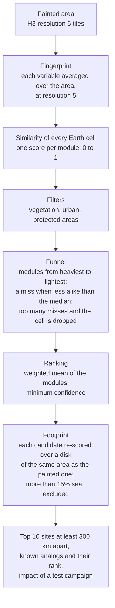

# AstroWrap server

FastAPI application, read-only over the preprocessing results in `pretreatment_data/`. The interface (`../ui`) calls it on http://127.0.0.1:8000.

## How the search works

`POST /api/search` (`services/combine.py`) compares a painted area with every land cell of the Earth, in about two
seconds, from tables already in memory (DuckDB over the Parquet files of `pretreatment_data/`).



| Step | Where | What it does |
|---|---|---|
| Fingerprint | `services/zones.py`, `combine.references` | Resolution 6 tiles are counted in their resolution 5 parents; each variable is averaged with these weights |
| Similarity | `services/scoring/` | One scorer per module, comparing values that mean the same thing on the three bodies |
| Funnel | `combine.search` | One weak point is forgiven when enough criteria are active, so a site very close on rocks but hilly can stay |
| Footprint | `services/footprint.py` | Area against area: the site is judged on the same surface as the painted area, not on a single cell |
| Impact | `services/impact.py` | Protected share, mines and airport distance, averaged over the footprint |

The interface re-ranks the pool in the browser when weights change, without a new request.

## Running

The simplest way is `npm install` then `npm start` in `../ui` (see `../ui/README.md`): it sets up `server/.venv` and starts the server. By hand, from `server/` (PowerShell; Linux, macOS: `source .venv/bin/activate`):

```bash
cd server
python -m venv .venv
.venv\Scripts\activate
pip install -r requirements.txt
uvicorn main:app --port 8000
```

From the repository root, the same app is `uvicorn server.main:app --port 8000`. `GET /api/health` tells when the Earth data is loaded (about 15 s after startup).

Settings are environment variables `ANALOGUES_<NAME>` (see `core/config.py`): `ANALOGUES_DATA` (module results, default `pretreatment_data/`), `ANALOGUES_CACHE` (default `server/cache/`), `ANALOGUES_CORS` (allowed origins, default `*`), `ANALOGUES_DUCKDB_MEMORY`, `ANALOGUES_DUCKDB_THREADS`.

Tests, from the repository root:

```bash
server/.venv/Scripts/python -m pip install -r server/requirements-dev.txt
server/.venv/Scripts/python -m pytest server/tests
```

## Data sources

| Source | Used for | Provider | Terms |
|---|---|---|---|
| Preprocessing module results (`pretreatment_data/`) | Every similarity score, site card values | This project (`modules_pretraitement/`) | See each module's README |
| [WDPA](https://www.protectedplanet.net) (World Database on Protected Areas) | Protected and strictly protected share of each site | UNEP-WCMC and IUCN | Non-commercial use; derived values only, with the citation and version |
| [OurAirports](https://ourairports.com/data/) | Nearest airport with scheduled flights | OurAirports | Public domain |
| [Global-scale mining polygons](https://doi.org/10.1594/PANGAEA.942325) (Maus et al. 2022) | Mine share of each site | Maus et al., PANGAEA | CC BY-SA 4.0 |
| [Natural Earth](https://www.naturalearthdata.com) (geography regions, countries) | Place names (deserts, mountain ranges, countries) | Natural Earth | Public domain |
| [OpenStreetMap Nominatim](https://nominatim.openstreetmap.org) | Locality, region and country of a site | OpenStreetMap contributors | ODbL; at most 1 request per second, results cached |
| [MOLA](https://astrogeology.usgs.gov/search/map/mars_mgs_mola_dem_463m) (Mars Global Surveyor), 463 m | 3D terrain of Mars | NASA, USGS Astrogeology | Public domain |
| [LOLA](https://astrogeology.usgs.gov/search/map/moon_lro_lola_dem_118m) (Lunar Reconnaissance Orbiter), 118 m | 3D terrain of the Moon | NASA, USGS Astrogeology | Public domain |
| [Copernicus DEM GLO-90](https://registry.opendata.aws/copernicus-dem/) | 3D terrain of the Earth | ESA, Copernicus programme (AWS Open Data) | Free use with attribution |
| [NASA Mars Trek](https://trek.nasa.gov/mars/) (Viking color mosaic) | 3D view imagery, Mars | NASA | Public domain |
| [NASA Moon Trek](https://trek.nasa.gov/moon/) (LRO WAC mosaic) | 3D view imagery, Moon | NASA | Public domain |
| [Esri World Imagery](https://www.arcgis.com/home/item.html?id=10df2279f9684e4a9f6a7f08febac2a9) | 3D view imagery, Earth | Esri, Maxar, Earthstar Geographics | Esri terms of use, attribution shown |
| Literature on known analogs (Haughton-Mars Project, Navarro-González et al. 2003, Doran et al. 2010, Fernández-Remolar et al. 2005, Horgan et al. 2020, AMASE expeditions, ESA PANGAEA training, Mars Society MDRS) | Known analogs returned with each search | Cited in `services/known_analogs.py` | Citation |
