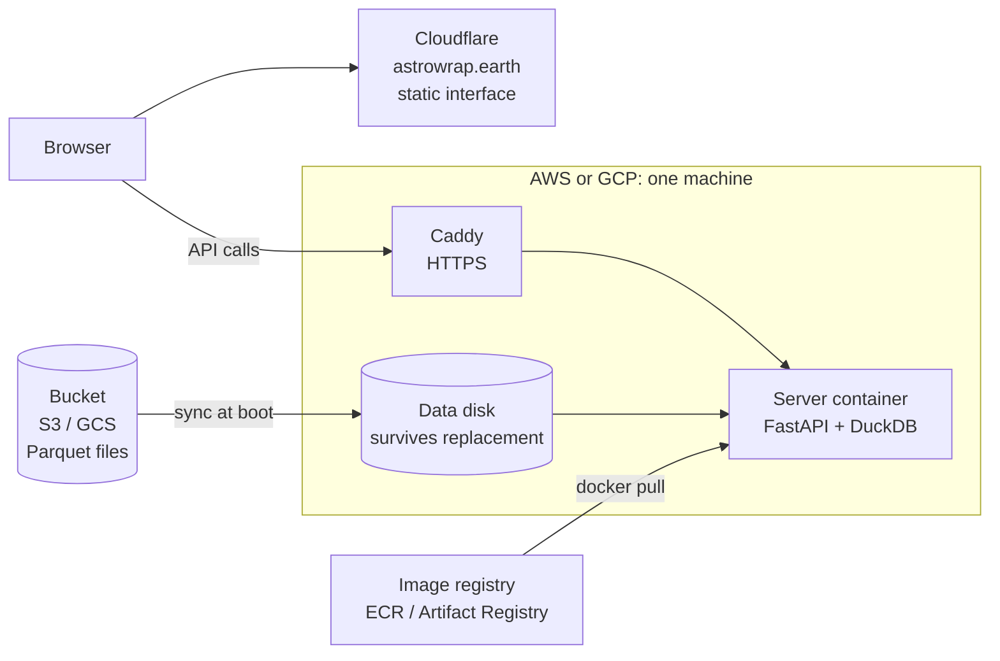

# Deploy

The same server image runs on AWS (`aws/`) and Google Cloud (`gcp/`), in two independent Terraform folders.
The interface is on Cloudflare.

| | URL |
|---|---|
| Site | https://astrowrap.earth |
| API (AWS) | https://api.astrowrap.earth/api/health |
| API (GCP) | https://api-gcp.astrowrap.earth/api/health |

## Architecture



| | AWS | GCP |
|---|---|---|
| Region | `ca-central-1` | `northamerica-northeast1` |
| Machine | `t4g.small` (ARM) | `e2-standard-2` |
| Group | Auto Scaling group, 0 to 1 machine | Managed instance group, 1 machine |
| Data disk | EBS, 10 GB | Stateful persistent disk, 10 GB |
| Data | S3 bucket | GCS bucket |
| Image | ECR | Artifact Registry |
| Shell access | SSM | SSH through IAP |
| Logs | CloudWatch `/<name>` | Cloud Logging |
| Alert | API down ~16 min, email | Uptime check, email |
| Budget | 1 USD per month, email at 100% | Email every 50 CAD, up to 200 CAD |

DNS (Cloudflare): `api` and `api-gcp` are A records to `terraform output ip`, DNS only (not proxied).

## Setup, once

Needs AWS CLI, gcloud, Terraform 1.10+ and Docker.

Each folder needs two private files (git-ignored):

| File | Content | Template |
|---|---|---|
| `backend.hcl` | Terraform state bucket | `backend.hcl.example` |
| `terraform.tfvars` | `name`, `alert_email`; GCP also `project`, `billing_account`, `data_device_name` | `variables.tf` |

```bash
terraform -chdir=aws init -backend-config=backend.hcl
export GOOGLE_OAUTH_ACCESS_TOKEN=$(gcloud auth print-access-token)
terraform -chdir=gcp init -backend-config=backend.hcl
```

## Everyday commands

From `server/deploy/`. Replace `both` with `aws` or `gcp` for one cloud.

| I changed… | Run | What happens |
|---|---|---|
| Server code | `./publish.sh both image` | Builds and pushes the image, then replaces the machine |
| Module results | `./publish.sh both data` | Syncs the Parquet files to the bucket, then the machine re-syncs and restarts the server |
| Both | `./publish.sh both` | Both of the above |
| Infrastructure | `terraform -chdir=aws plan`, then `apply` | |
| The interface | `cd ui && npm run site && npx wrangler deploy` | Builds `dist/` and uploads it to Cloudflare |

| I want to… | AWS | GCP |
|---|---|---|
| Stop the API | `aws autoscaling update-auto-scaling-group --auto-scaling-group-name <name> --desired-capacity 0` | `gcloud compute instance-groups managed resize <name> --size 0 --zone <zone>` |
| Open a shell | `aws ssm start-session --target <instance>` | `gcloud compute ssh <vm> --zone <zone> --tunnel-through-iap` |
| Follow the logs | `MSYS_NO_PATHCONV=1 aws logs tail /<name> --follow` | Cloud Logging (`gcplogs-docker-driver`) |
| Check it's up | `curl https://api.astrowrap.earth/api/health` | `curl https://api-gcp.astrowrap.earth/api/health` |

## Machine boot

| Step | Detail |
|---|---|
| 1. Attach the data disk | Same disk every time, so the data is already there after a replacement |
| 2. Sync the data | Bucket to `/data/app/pretreatment_data`, only once `_READY` is in the bucket |
| 3. Pull and start | Server container, then Caddy for HTTPS |
| 4. Healthy | `GET /api/health` answers about 10 s later |

| File | Role |
|---|---|
| `publish.sh` | Image and data publishing, both clouds |
| `aws/main.tf`, `gcp/main.tf` | Network, machine, disk, bucket, registry, permissions |
| `aws/monitoring.tf`, `gcp/monitoring.tf` | Logs, alerts, budget |
| `aws/user_data.sh.tftpl`, `gcp/startup.sh.tftpl` | Machine boot script |
| `*/outputs.tf` | `ip`, `bucket`, `group`, image and registry names, read by `publish.sh` |
