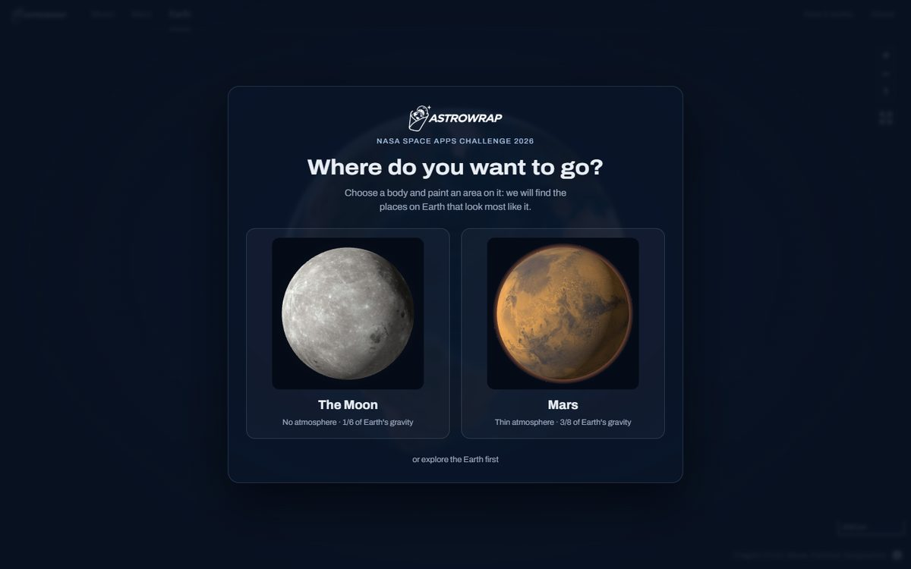
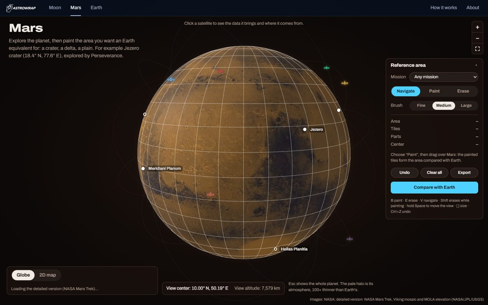
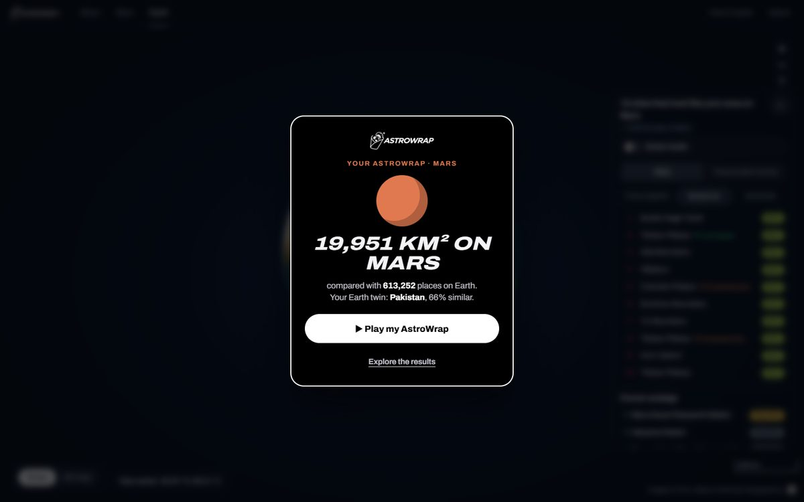
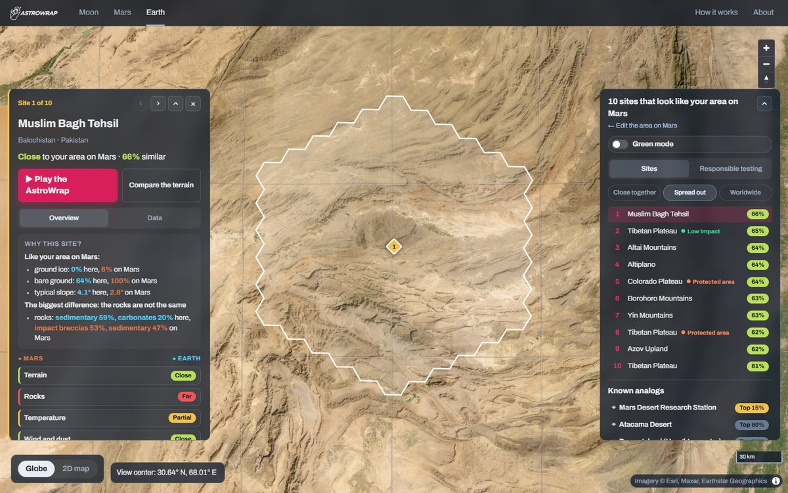
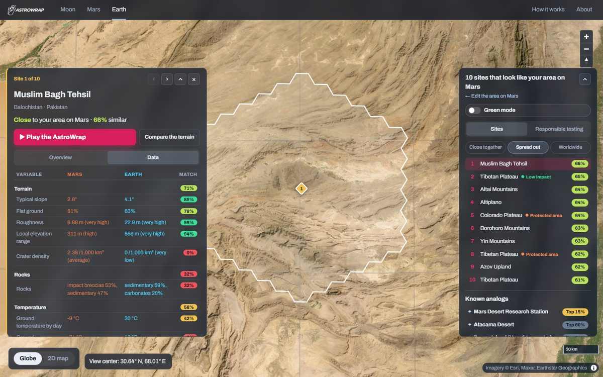
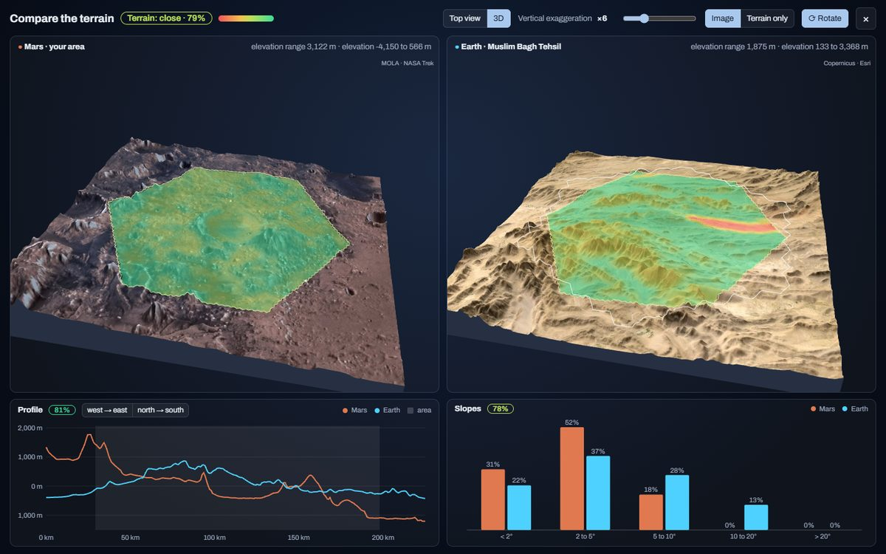
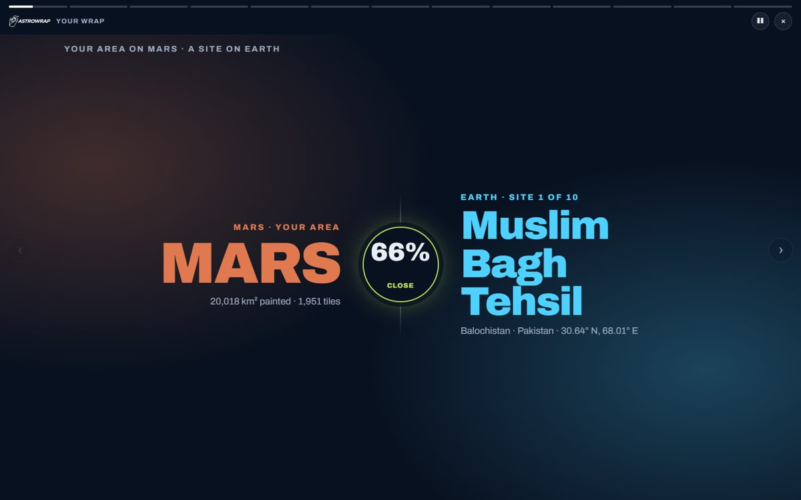
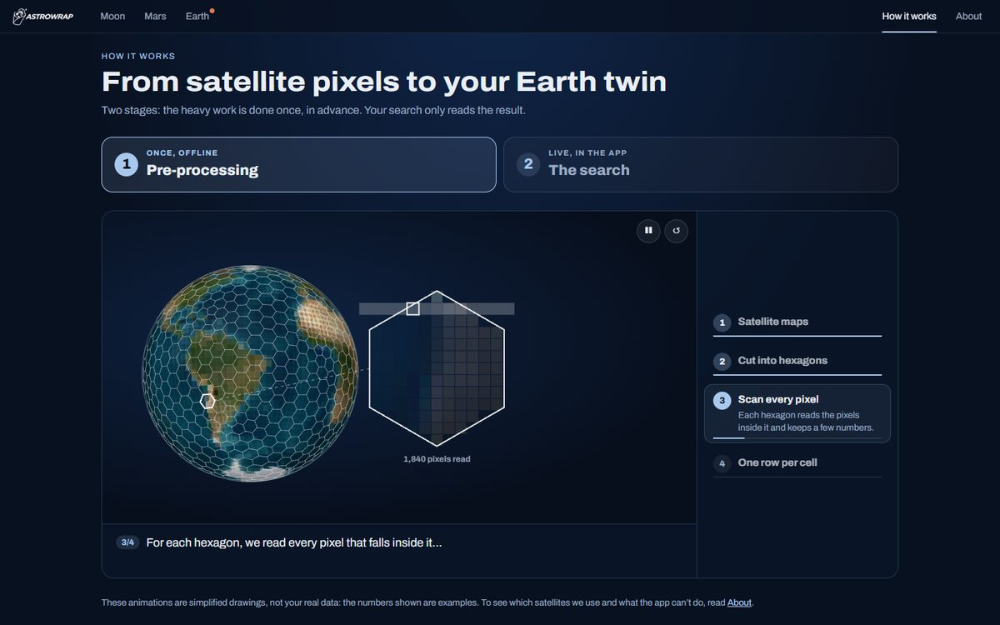

# AstroWrap web interface

Paint an area on the Moon or Mars, get the 10 places on Earth that look most like it.
Plain HTML, CSS and JavaScript: no framework, no bundler. Live at [astrowrap.earth](https://astrowrap.earth).

## Quick start

```bash
cd ui
npm install    # libraries + server/.venv
npm start      # interface http://localhost:8080 + API http://127.0.0.1:8000
```

| Command | Starts |
|---|---|
| `npm start` | Interface and API |
| `npm run client` | Interface only (API elsewhere: add `?api=http://host:port` to the URL) |
| `npm run api` | API only |

Needs Node.js 18+, Python 3.9 to 3.12, and the module results in `pretreatment_data/` ([server README](../server/README.md)).

## Tour

<table>
<tr>
<td width="50%"><br><b>1. Choose a body</b><br><code>index.html</code></td>
<td width="50%"><br><b>2. Paint an area</b>, then <i>Compare with Earth</i><br><code>mars.html</code>, <code>lune.html</code></td>
</tr>
<tr>
<td><br><b>3. The search runs</b> (about 2 s)<br>613,252 Earth cells compared</td>
<td><br><b>4. Top 10 sites</b>, at least 300 km apart<br>Site card on the left, ranking and weights on the right</td>
</tr>
<tr>
<td><br><b>5. Data tab</b>: every variable, Mars vs Earth, with its match</td>
<td><br><b>6. Compare the terrain</b>: 3D, profile, slopes<br>Green: this terrain exists on the other side. Red: it doesn't</td>
</tr>
<tr>
<td><br><b>7. Play the AstroWrap</b>: animated recap, ends with live warnings around the site<br><code>bilan.html</code></td>
<td><br><b>How it works</b>: the pipeline, animated<br><code>fonctionnement.html</code></td>
</tr>
</table>

## Pages

| Page | What | Main files |
|---|---|---|
| `index.html` | Home, Earth globe (3D or 2D), results | `js/accueil.js`, `js/globe-terre.js`, `js/analogues.js`, `js/vue-3d.js` |
| `mars.html`, `lune.html` | Globe, 2D map, area painting, landmarks | `js/globe-mars.js`, `js/globe-lune.js`, `js/selection-zone.js`, `js/reperes.js` |
| `bilan.html` | AstroWrap recap | `js/bilan.js`, `js/wrap-environnement.js` |
| `fonctionnement.html` | How it works | `js/fonctionnement.js` |
| `apropos.html` | About: method, limits, sources, team | `css/pages.css` |
| every page except the recap | Navigation bar | `js/navigation.js` |

## Controls

| Action | Mouse | Keyboard | Touch |
|---|---|---|---|
| Rotate | Drag | Arrows | Drag |
| Zoom | Wheel, double-click | `+` `−` | Pinch |
| Whole planet | | `Esc` | |
| Paint | *Paint*, then drag | `B` | |
| Erase | *Erase*, or `Shift` while painting | `E` | |
| Navigate | *Navigate* | `V` | |
| Move while painting | | `Space` + drag | |
| Brush size | Fine, Medium, Large | `[` `]` | |
| Undo | *Undo* | `Ctrl+Z` | |
| Previous, next site | `‹` `›` | `←` `→` | |

## Painting an area

| | |
|---|---|
| Cells | H3 resolution 6: Mars ~10 km², Moon ~2.7 km² |
| Size | 10 to 60,000 cells |
| Brush | Follows the zoom: big cells from afar, single cells up close |
| Saved in | The browser (`localStorage`); for the results, on the server under a 12-character id (`index.html#mars/<id>`) |
| Export | JSON of compacted cells; full list in Python: `h3.uncompact_cells(cells, 6)` |

## Settings

| Variable | Default | Effect |
|---|---|---|
| `PORT` | `8080` | Interface port |
| `API_PORT` | `8000` | API port |
| `?api=…` in the URL | local: `http://127.0.0.1:8000`, online: `https://api.astrowrap.earth` | API used by the pages, kept from page to page |
| `ANALOGUES_PYTHON` | first Python found | Python used for `server/.venv` |
| `ANALOGUES_SANS_PYTHON=1` | | `npm install` skips the Python step |

Libraries load from `node_modules/`, or from unpkg / jsDelivr when missing. Imagery and fonts need Internet.

## Imagery

| Body | Globe | 2D map | Notes |
|---|---|---|---|
| Earth | Esri World Imagery | Esri World Imagery | |
| Mars | NASA 1440 px (embedded), then 4096 px from Mars Trek (Viking + MOLA) | Mars Trek tiles, down to ~232 m/px | Falls back to the embedded map if Trek refuses |
| Moon | NASA SVS [CGI Moon Kit](https://svs.gsfc.nasa.gov/4720) (LROC + LOLA), 4096 px then 8192 px | Moon Trek tiles (LRO WAC) | Display only, not for measurements |

Textures are stored as `.js` (`textures/`) so 3D works even from a double-clicked file.

## Project structure

```text
index.html  mars.html  lune.html  bilan.html  fonctionnement.html  apropos.html
js/
  navigation.js         nav bar on every page
  accueil.js            home: Moon and Mars to choose
  globe-terre.js        Earth globe and 2D map (MapLibre)
  globe-mars.js         Mars globe (globe.gl, Mars Trek)
  globe-lune.js         Moon globe (globe.gl)
  carte-plane.js        2D map of Mars and the Moon (Leaflet)
  selection-zone.js     area painting (H3)
  reperes.js            landing sites and landmarks
  satellites.js         satellites around the globes, one per module
  analogues.js          search, results, site card
  vue-3d.js             Compare the terrain
  bilan.js              AstroWrap recap
  relief-bilan.js       terrain square for the recap's 3D slide
  wrap-environnement.js live warnings around a site (public APIs)
  villes.js             departure cities, for the flight CO₂
  fonctionnement.js     How it works animations
css/                    one file per page or component
textures/               Moon and Mars imagery as .js
scripts/                npm start, npm install, npm run site
```
